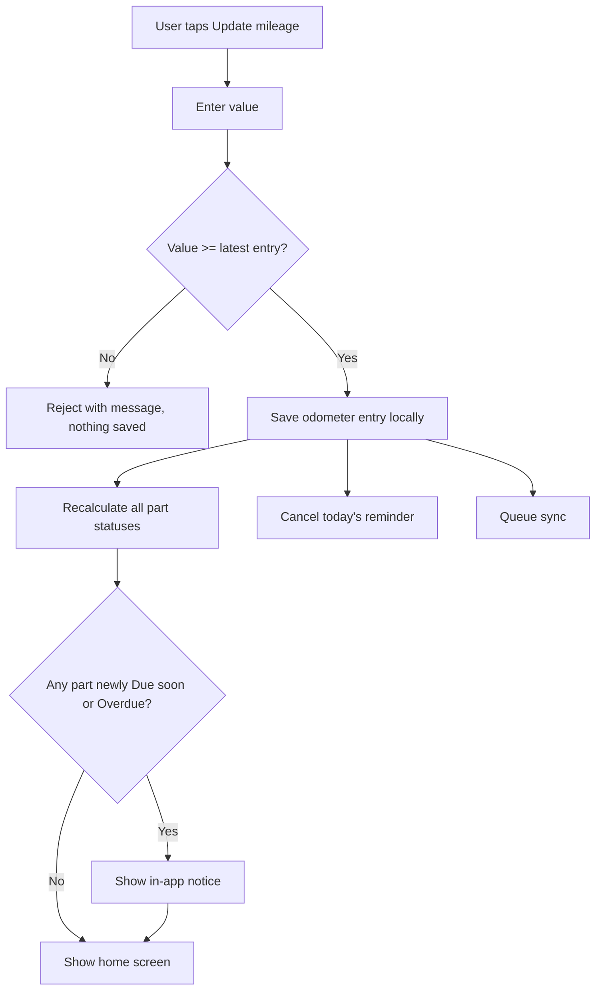
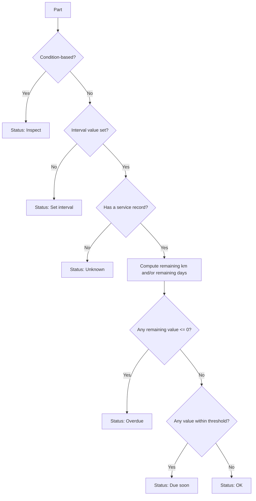

# 02 · Product Requirements Document (PRD)

| Field | Value |
|---|---|
| Project | Car Maintenance Tracker (working title, OQ-05) |
| Version | 0.5 (approved 2026-11-01; §8 aligned with D-58) |
| Date | 2026-11-01 |
| Owner | Salmen Ben Ammar |
| Related | [PVD](../01-discovery/01-product-vision.md), [SRS](../03-technical-specifications/03-srs.md), [README](../README.md) |

**Legend.** `D-xx` confirmed decision, `A-xx` assumption needing approval, `OQ-xx` open question, `F-xx` feature, `US-xx` user story, `BR-xx` business rule, `AC-xx` acceptance criterion. Registers are in the README.

---

## 1. Product overview

See PVD §1. In short: the owner enters the odometer, and the app shows remaining distance and time for every tracked part of a petrol or diesel car. Data is local-first and synced.

## 2. Glossary (terms used in all documents)

| Term | Meaning |
|---|---|
| Car | A vehicle with a profile (name, fuel, timing drive, gearbox, DPF, odometer). |
| Odometer entry | A dated mileage reading. Entries never decrease (BR-01). |
| Category | A group of parts (Engine, Filters, Fuel, Brakes, Fluids, Tires, Electrical, Visibility, Emissions, plus custom). |
| Part | A tracked item (e.g. Engine oil). Created from a template or by the owner (custom part). |
| Part template | A default part definition shipped with the app (Appendix A). |
| Distance interval | Kilometres between services. Always stored in km (BR-11). |
| Time interval | Calendar months between services (A-07). |
| Condition-based part | A part with no countdown. It is inspected, not scheduled (BR-08). |
| Service record | A replacement entry: km, date, optional cost, optional notes (D-12). |
| Inspection record | A dated "inspected" mark for a condition-based part (A-16). |
| Inspection due | A flag on a condition-based part whose inspection period (default 3 months) has elapsed (BR-08). |
| Baseline record | A service record created by first-time setup or "all serviced today". It anchors status but is shown as "Initial" and excluded from cost totals (BR-16). |
| Date unknown | Shown on the time side of a part whose service km is known but whose service date is not (BR-20). |
| Status | One of OK, Due soon, Overdue, Unknown, Inspect, Set interval (BR-05). |
| Reminder | The daily local notification asking the owner to update the mileage (D-10). |
| Alert | A local notification about a specific part (D-11). |

## 3. Features and priorities

### 3.1 Feature list (MoSCoW)

Must Have = Release 1 (MVP). Should Have = Release 2. Could Have = Release 3 / public-release phase. The release split is a proposal, confirmed in the roadmap.

| ID | Feature | Description | Priority | Release | Basis |
|---|---|---|---|---|---|
| F-01 | Authentication | Sign up and sign in with email/password and Google. Password reset for email accounts. Stay signed in. | Must | R1 | D-04 |
| F-02 | Car profile | Create a car: name, fuel (petrol/diesel), timing belt or chain, manual or automatic, DPF yes/no (diesel only), current odometer. | Must | R1 | D-09, D-15 |
| F-03 | Odometer update and history | Enter the current mileage. It must not be lower than the latest entry. List, edit, and delete the latest entry. | Must | R1 | D-05, A-02, A-03 |
| F-04 | Default parts and categories | Default parts grouped in categories, shown according to the car profile. | Must | R1 | D-08, D-09 |
| F-05 | Part tracking and status | Remaining distance/time and status per part. A per-part "warn earlier" setting is a Should Have (R2). | Must | R1 | D-06, D-07, D-22 |
| F-06 | Custom parts | Add own parts in any category (distance, time, both, or condition-based). Edit intervals of any part. Custom categories are a Should Have. | Must (parts), Should (categories) | R1 / R2 | D-08, A-11 |
| F-07 | Mark as replaced, service history | Record a replacement and reset the counters. Keep history per part. Mark a condition-based part as inspected. | Must | R1 | D-06, D-12, D-25, A-16 |
| F-08 | First-time setup | Enter the last-change km per part at setup. Skipped parts show "Unknown, check it". Bulk "all serviced today" action. | Must | R1 | D-13 |
| F-09 | Home screen | Car header with odometer and Update mileage button, Needs attention list (Overdue, inspection due, Due soon), collapsible categories with "+ Add part", part detail. | Must | R1 | D-14 |
| F-10 | Mileage reminder and inspection prompts | Daily local notification at a chosen time, skipped if mileage was updated that day. Includes periodic inspection prompts. | Must | R1 | D-10, A-08, A-09 |
| F-11 | Part alerts | Per-part alerts for time-sensitive parts (e.g. engine oil). | Must | R1 | D-11, A-05, A-06 |
| F-12 | Offline use | All core functions work without a connection. Data stored on the device. | Must | R1 | D-02 |
| F-13 | Cloud sync | Sync data across devices and restore it on a new phone. | Must | R1 | D-02, D-03, D-23 |
| F-14 | Settings | Reminder on/off and time, account (email, sign out), currency, app version. | Must | R1 | D-10, A-12 |
| F-15 | Data export | Export all data as JSON/CSV. | Should | R2 | PVD §6 |
| F-16 | Units km/miles | Setting for display units. Storage stays in km. | Should | R2 | D-16 |
| F-17 | French and Arabic | Translations and right-to-left layout. English is available from R1. | Should | R2 | D-16 |
| F-21 | Delete account and data | Remove the account and all its data from the app. | Should | R2 | A-14 |
| F-18 | Multi-car interface | Switch between several cars. The data model supports it from R1. | Could | R3 | D-21 |
| F-19 | Ads and ad removal | AdMob ads for free users, paid option to remove them. | Could | R3 | D-17 |
| F-20 | Store release | Google Play and App Store publication. | Could | R3 | D-18 |

### 3.2 Won't Have (this version)

| Item | Reason |
|---|---|
| Automatic mileage reading (OBD-II, GPS, background tracking) | The app depends on manual entry by design (D-11). |
| Photos and receipts, garage records, fuel logs | Explicitly deferred by the owner. |
| Electric and hybrid vehicles | Scope is petrol and diesel (D-15). |
| Web app | Mobile only (D-01). |

## 4. User stories

| ID | As a... | I want to... | So that... | Feature | Priority |
|---|---|---|---|---|---|
| US-01 | owner | sign up and sign in with email or Google | my data follows me | F-01 | Must |
| US-02 | owner | create my car with its fuel, belt/chain, gearbox and DPF | the app shows only relevant parts | F-02 | Must |
| US-03 | owner | enter the current mileage | all parts update | F-03 | Must |
| US-04 | owner | be stopped from entering a lower mileage | I do not corrupt my data | F-03 | Must |
| US-05 | owner | see remaining km and time per part | I know what is due | F-05 | Must |
| US-06 | owner | see which parts need attention first | I act on the urgent ones | F-09 | Must |
| US-07 | owner | record that I replaced a part at a given km and date | its counter restarts | F-07 | Must |
| US-08 | owner | add a custom part with my own interval | I track what my car needs | F-06 | Must |
| US-09 | owner | enter last-change km for each part at setup, or skip | statuses are honest | F-08 | Must |
| US-10 | owner | get a daily reminder to update the mileage, but not after I already did | I keep the data current | F-10 | Must |
| US-11 | owner | be reminded to inspect condition-based parts | I do not forget brakes and similar parts | F-10 | Must |
| US-12 | owner | get alerts for time-sensitive parts | oil does not expire unnoticed | F-11 | Must |
| US-13 | owner | use the app offline | a missing signal never blocks me | F-12 | Must |
| US-14 | owner | find my data on a new phone | I never lose my history | F-13 | Must |
| US-15 | owner | export my data | I keep a copy outside the app | F-15 | Should |
| US-16 | owner | use miles and my language (English, French, Arabic) | the app matches my preference | F-16, F-17 | Should |

## 5. User journeys

**J-01 First launch.** Sign in, create the car profile, enter the odometer, review the default parts, enter the last-change km and, optionally, the last-change date for the parts I know (or skip), reach the home screen.

**J-02 Regular update.** A reminder appears, I tap it, enter the mileage, and see the updated statuses (flowchart below).

**J-03 Replace a part.** Open the part, tap "Mark as replaced", confirm km and date (defaults: current odometer and today), optionally add cost and notes, and save. The part shows its full interval again.

**J-04 Add a custom part.** In a category, tap "+ Add part", enter the name and interval type, and save. The part behaves like any default part.

**J-05 New phone.** Install, sign in, and wait for sync. The car, parts, and history appear.

## 6. Business rules

| ID | Rule | Basis |
|---|---|---|
| BR-01 | A new odometer entry must be greater than or equal to the latest entry. A lower value is rejected. An equal value is accepted and changes nothing. Only the latest entry (the greatest km) can be edited or deleted, after confirmation, and the last remaining entry cannot be deleted. After a merge from several devices the current odometer is the greatest entry and this rule applies to new entries only; a legitimate decrease from an instrument cluster replacement is unsupported (D-31). | D-05, A-02, D-31 |
| BR-02 | Remaining distance = distance interval − (current odometer − service km). A negative result means overdue by that distance. | D-06 |
| BR-03 | Due date = service date + time interval (calendar months). If the target month is shorter, the due date is the last day of that month (31 Jan + 1 month = 28 or 29 Feb). Remaining days = due date − today. | D-07, A-07, D-30 |
| BR-04 | If a part has both intervals, its status is the more urgent of the two ("whichever comes first"). | D-07 |
| BR-05 | Status values, evaluated in this order: **Inspect** (condition-based part). **Set interval** (the part has no interval value yet, BR-12). **Unknown** (no service record; a time-only part whose service date is unknown; or a distance-only part whose service km is unknown, BR-20). **Overdue** (any remaining value ≤ 0). **Due soon** (remaining distance ≤ min(half the distance interval, 1,000 km), or remaining days ≤ min(30, half the days between the service date and the due date), unless the part has its own "warn earlier" value; D-53). **OK** otherwise. | D-22 |
| BR-06 | Marking a part as replaced sets its last-service km and date, restarts both counters, and keeps all earlier records as history. Example: replaced at 320,000 km, interval 70,000 km, odometer 340,000 km, remaining 50,000 km. | D-06 |
| BR-07 | A service record's km cannot exceed the current odometer, and its date cannot be in the future. Backdating is allowed. The active record of a part is the one with the greatest service date, ties broken by the greatest service km; records with an unknown date rank after dated records (D-42). Both counters restart from that record. Records can be edited and deleted. | A-04, D-25 |
| BR-08 | A condition-based part has no countdown and shows "Inspect". It is included in the reminder as an inspection prompt every 3 months by default (adjustable per part), counted from the latest of its last inspection, its last service record, and its creation. When that period has elapsed, the part is flagged "inspection due" and is listed in Needs attention, after Overdue and before Due soon. | D-10, A-09, A-16, D-27, D-52 |
| BR-09 | The daily reminder fires at the chosen time (default 20:00) unless the odometer was already updated that day. | D-10, A-08 |
| BR-10 | Part alerts are local notifications for parts with a time interval, switchable per part (default on). Distance-based statuses refresh when the odometer is updated or the app opens. No background mileage tracking. | D-11, A-05, A-06 |
| BR-11 | Distances are stored in km. Miles are a display conversion (Release 2). | D-16 |
| BR-12 | The timing belt appears only for cars with a belt. The timing belt and the gearbox oil have no pre-filled interval: the owner enters it from the car's manual. Until then the part shows "Set interval". | D-09 |
| BR-13 | Default parts are shown according to the car profile (Appendix A). Hidden templates can be added later through "+ Add part". | D-09 |
| BR-14 | Default and custom parts behave identically. Intervals of any part are editable. The car's manual takes priority over any default. | D-08, D-09 |
| BR-15 | Every record belongs to exactly one user. Records are never visible to other users. | D-19 |
| BR-16 | First-time setup entries and the "all serviced today" action create baseline service records. A baseline record anchors the part's status, appears as "Initial" in history, and is excluded from cost totals. | D-26 |
| BR-17 | After the first sign-in, local reads and writes never depend on a valid authentication token. Sign-in gates only synchronization and account actions. | D-28 |
| BR-18 | Odometer and service dates are stored as local calendar dates (YYYY-MM-DD). Sync timestamps are UTC. Each service record stores its own currency code, and the currency setting only supplies the default for new records. | D-29 |
| BR-19 | When the same record changes on several devices, the version with the latest update time wins. Deletions are soft deletes so they reach every device. | D-23 |
| BR-20 | Service km and service date are independent anchors. If the km is known but the date is not, the distance countdown is shown normally and the time side shows "date unknown": such a part cannot be Due soon or Overdue by time. If the date is known but the km is not, the time countdown is shown normally and the distance side shows "km unknown": such a part cannot be Due soon or Overdue by distance. A time-only part (brake fluid, battery, wipers) without a date has the status Unknown, and so does a distance-only part without a km. | D-32, D-51 |

## 7. Acceptance criteria

| ID | Feature | Given / When / Then |
|---|---|---|
| AC-01 | F-03 | Given the latest odometer is 120,500, when I enter 120,400, then the entry is rejected with a message and the stored value is unchanged. |
| AC-02 | F-03, F-05 | Given the latest odometer is 120,000 and engine oil (10,000 km) was changed at 120,000, when I enter 120,070, then engine oil shows 9,930 km remaining. |
| AC-03 | F-07 | Given a part replaced at 320,000 km with a 70,000 km interval, when the odometer is 340,000, then it shows 50,000 km remaining. |
| AC-04 | F-05 | Given engine oil with a 12-month interval serviced on 2026-01-15, when today is 2026-12-20, then its status is Due soon (26 days left). |
| AC-05 | F-05 | Given a part with 6,000 km remaining (OK) and a time interval 10 days past due, then its status is Overdue. |
| AC-06 | F-05 | Given brake pads are condition-based, then they show "Inspect" and no remaining value. |
| AC-07 | F-08 | Given I skipped a part at setup, then it shows "Unknown, check it". When I enter its last-change km, then it shows a normal status. |
| AC-08 | F-08 | Given I tap "all serviced today", then every part gets a baseline service record with km = current odometer and date = today, shown as "Initial" in history. |
| AC-09 | F-10 | Given a 20:00 reminder and I updated the mileage at 18:00, then no reminder appears at 20:00. Given I did not update, then a reminder appears at 20:00. |
| AC-10 | F-10 | Given a condition-based part not inspected for 3 months, then the reminder summary includes it (a count plus the most urgent item). |
| AC-11 | F-06 | Given I add "Power steering fluid" with 40,000 km in Fluids, then it appears in Fluids and updates like a default part. |
| AC-12 | F-07 | Given the odometer is 120,000, when I record a replacement at 121,000, then it is rejected. |
| AC-13 | F-12 | Given airplane mode, when I update the mileage, then it is saved and statuses update. |
| AC-14 | F-13 | Given two signed-in devices, when I update on one, then the other shows the change after sync. |
| AC-15 | F-01 | Given a new user, I can sign up with email/password and with Google, and stay signed in after restart. |
| AC-16 | F-11 | Given engine oil with alerts on, when it enters the Due soon window, then a local notification is delivered. With alerts off, none is delivered. |
| AC-17 | F-06 | Given a custom part with history, when I delete it and confirm, then the part and its history disappear (also on my other devices after sync). If I cancel, nothing changes. Hiding a default part keeps its history. |
| AC-18 | F-07 | Given a part with two service records, when I edit the older record, then the active record is the one with the latest date (ties: higher km) and the remaining values are recomputed from it. |
| AC-19 | F-13 | Given an account with data, when I sign in on a new phone, then the car, odometer entries, parts and service history appear after sync with the same statuses. |
| AC-20 | F-10 | Given notification permission is denied, then the app explains how to enable it, every other function keeps working, and no reminder or alert is scheduled. |
| AC-21 | F-01 | Given a signed-in user whose token has expired and no network, when the app restarts, then the car, odometer, parts and history are shown and editable, the sync state shows Offline, and the pending changes upload after the token refreshes. |
| AC-22 | F-10 | Given a 30-day reminder window and a 20:00 reminder, when I update the mileage at 18:00, then no reminder fires that day and the window is rebuilt from tomorrow. When 30 days pass without the app being opened, then the last notification states that reminders are paused and no further notification is delivered. |
| AC-23 | F-05 (second sentence: R2) | Given a custom part with an 800 km interval replaced at the current odometer, then it is OK (not Due soon) and becomes Due soon at 400 km remaining. A "warn earlier" value equal to or above the interval is rejected. |
| AC-24 | F-08 | Given setup, when I enter a last-change km for engine oil but no date, then the distance countdown is shown and the time side shows "date unknown". When I enter a date for brake fluid, then its due date is computed from that date. When I enter a date for a distance-only part but no km, then the time side is shown, the distance side shows "km unknown", and the status is Unknown. When I skip both for the battery, then it shows Unknown. |

## 8. MVP definition

**Release 1 (MVP)** contains F-01 to F-14, in English, with kilometres only. It runs on Android (installed directly) and on iPhone (sideloaded IPA) (D-18). Cloud sync (F-13) runs on one Supabase project (D-03, D-58), proven by spike S-01 before the main build; OQ-01 is closed.

**Definition of done for the MVP:** all Must Have acceptance criteria (AC-01 to AC-24, excluding the Release 2 "warn earlier" clause of AC-23) pass on a real device, offline and online, and the test cases of the QA plan (document 11) cover the remaining Must Have requirements.

## 9. Dependencies between features

| Feature | Depends on |
|---|---|
| F-02 Car profile | F-01 |
| F-04 Default parts | F-02 |
| F-05 Status | F-03, F-04 |
| F-07 Replacement | F-05 |
| F-08 First-time setup | F-04 |
| F-09 Home screen | F-05, F-06 |
| F-10 Reminder | F-03, F-14 |
| F-11 Part alerts | F-05, F-14 |
| F-13 Sync | F-01, F-12 |
| F-15, F-16, F-17, F-21 | R1 complete |
| F-18, F-19, F-20 | R2 complete (F-19 also needs F-01 and F-13) |

---

## Appendix A. Default parts catalog (approved, D-09)

Intervals are editable starting points. Distance in km, time in months. "Profile rule" decides whether the part is shown by default.

| Category | Part | Profile rule | Type | Default interval |
|---|---|---|---|---|
| Engine | Engine oil and oil filter | All | Distance + time | 10,000 km / 12 months |
| Engine | Spark plugs | Petrol | Distance | 30,000 km |
| Engine | Timing belt | Cars with a belt | Distance + time | None, owner enters it (BR-12) |
| Engine | Drive/serpentine belt | All | Condition-based | Inspect |
| Filters | Air filter | All | Distance | 15,000 km |
| Filters | Cabin filter | All | Distance + time | 20,000 km / 12 months |
| Fuel | Fuel filter | Diesel (petrol can add it) | Distance | 30,000 km |
| Fuel | Glow plugs | Diesel | Distance | 120,000 km |
| Brakes | Brake fluid | All | Time | 24 months |
| Brakes | Brake pads and discs | All | Condition-based | Inspect |
| Fluids | Coolant | All | Distance + time | 100,000 km / 60 months |
| Fluids | Transmission or gearbox oil | All | Distance | Owner enters it from the manual |
| Tires | Rotation | All | Distance | 10,000 km |
| Tires | Replacement and alignment | All | Condition-based | Inspect |
| Electrical | Battery | All | Time | 48 months |
| Visibility | Wiper blades | All | Time | 12 months |
| Emissions | DPF | Diesel with DPF | Condition-based | Inspect |

Notes:
- Engine oil and oil filter are tracked as separate parts that share the same default interval (matching the owner's original example). The table lists them on one line only for brevity.
- Defaults are a proposal derived from public maintenance guidance, and the car's manual always takes priority (BR-14). Gearbox oil and timing belt have no number on purpose.
- The profile records the gearbox type, but no default part depends on it yet (D-09).
