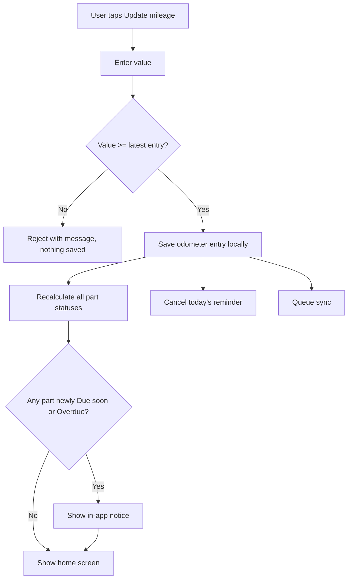
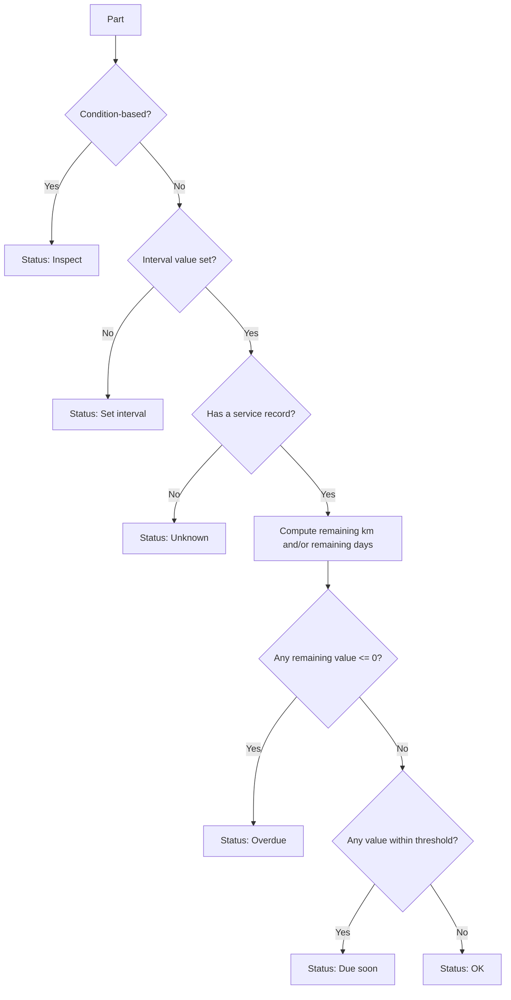

# PRD · User journeys and business rules

> Part of [02-prd.md](../02-prd.md). Sections: §5, §6. Section numbers are unchanged, so references such as "doc 07 §5.2" still resolve.

## 5. User journeys

**J-01 First launch.** Create the car profile, enter the odometer, review the default parts, enter the last-change km and, optionally, the last-change date for the parts I know (or skip), and reach the home screen. Account connection is offered later in Settings and is never required for this journey.

**J-02 Regular update.** A reminder appears, I tap it, enter the mileage, and see the updated statuses (flowchart below).

**J-03 Replace a part.** Open the part, tap "Mark as replaced", confirm km and date (defaults: current odometer and today), optionally add cost and notes, and save. The part shows its full interval again.

**J-04 Add a custom part.** In a category, tap "+ Add part", enter the name and interval type, and save. The part behaves like any default part.

**J-05 New phone.** Install, sign in, and wait for sync. The car, parts, and history appear.

**J-06 Connect an account.** From Settings, choose email/password or Google. The app first checks the account's cloud data. If it is empty, review the number of local records to upload and confirm. If it has data, either use its validated cloud copy (after an optional JSON backup) or cancel; no automatic merge occurs.

## 6. Business rules

| ID | Rule | Basis |
|---|---|---|
| BR-01 | A new odometer entry must be greater than or equal to the latest entry. A lower value is rejected. An equal value is accepted and changes nothing. Only the latest entry (the greatest km) can be edited or deleted, after confirmation, and the last remaining entry cannot be deleted. After a merge from several devices the current odometer is the greatest entry and this rule applies to new entries only; a legitimate decrease from an instrument cluster replacement is unsupported (D-31). | D-05, A-02, D-31 |
| BR-02 | Remaining distance = distance interval − (current odometer − service km). A negative result means overdue by that distance. | D-06 |
| BR-03 | Due date = service date + time interval (calendar months). If the target month is shorter, the due date is the last day of that month (31 Jan + 1 month = 28 or 29 Feb). Remaining days = due date − today. | D-07, A-07, D-30 |
| BR-04 | If a part has both intervals, its status is the more urgent of the two ("whichever comes first"). | D-07 |
| BR-05 | Status values, evaluated in this order: **Inspect** (condition-based part). **Set interval** (the part has no interval value yet, BR-12). **Unknown** (no service record; a time-only part whose service date is unknown; or a distance-only part whose service km is unknown, BR-20). **Overdue** (any remaining value ≤ 0). **Due soon** (remaining distance ≤ min(half the distance interval, 1,000 km), or remaining days ≤ min(30, half the days between the service date and the due date), unless the part has its own "warn earlier" value; D-53). **OK** otherwise. | D-22 |
| BR-06 | Marking a part as replaced sets its last-service km and date, restarts both counters, and keeps all earlier records as history. Example: replaced at 320,000 km, interval 70,000 km, odometer 340,000 km, remaining 50,000 km. | D-06 |
| BR-07 | A service record's km cannot exceed the current odometer, and its date cannot be in the future. Backdating is allowed. The active record of a part is the one with the greatest service date, ties broken by the greatest service km; records with an unknown date rank after dated records (D-42). Both counters restart from that record. Records can be edited and deleted. | A-04, D-25 |
| BR-08 | A condition-based part has no countdown and shows "Inspect". It is included in the reminder as an inspection prompt every 3 months by default (adjustable per part), counted from the latest of its last inspection, its last service record, and its creation. When that period has elapsed, the part is flagged "inspection due" and is listed in Needs attention, after Overdue and before Due soon. | D-10, A-09, A-16, D-27, D-52 |
| BR-09 | The daily reminder fires at the chosen time (default 20:00) unless the odometer was already updated that day. | D-10, A-08 |
| BR-10 | Part alerts are local notifications for parts with a time interval, switchable per part (default on). Distance-based statuses refresh when the odometer is updated or the app opens. No background mileage tracking. | D-11, A-05, A-06 |
| BR-11 | Distances are stored in km. Miles are a display conversion (Release 2). | D-16 |
| BR-12 | The timing belt appears only for cars with a belt. The timing belt and the gearbox oil have no pre-filled interval: the owner enters it from the car's manual. Until then the part shows "Set interval". | D-09 |
| BR-13 | Default parts are shown according to the car profile (Appendix A). Hidden templates can be added later through "+ Add part". | D-09 |
| BR-14 | Default and custom parts behave identically. Intervals of any part are editable. The car's manual takes priority over any default. | D-08, D-09 |
| BR-15 | Every cloud record belongs to exactly one authenticated user and is never visible to another user. Before account connection, one device-local profile owns the local records and they are never sent to the cloud. | D-107, D-110 |
| BR-16 | First-time setup entries and the "all serviced today" action create baseline service records. A baseline record anchors the part's status, appears as "Initial" in history, and is excluded from cost totals. | D-26 |
| BR-17 | From first launch, local reads and writes never depend on a valid authentication token or an account. Account connection gates only synchronization and account actions. | D-28, D-107 |
| BR-18 | Odometer and service dates are stored as local calendar dates (YYYY-MM-DD). Sync timestamps are UTC. Each service record stores its own currency code, and the currency setting only supplies the default for new records. | D-29 |
| BR-19 | When the same record changes on several devices, the version with the latest update time wins. Deletions are soft deletes so they reach every device. | D-23 |
| BR-20 | Service km and service date are independent anchors. If the km is known but the date is not, the distance countdown is shown normally and the time side shows "date unknown": such a part cannot be Due soon or Overdue by time. If the date is known but the km is not, the time countdown is shown normally and the distance side shows "km unknown": such a part cannot be Due soon or Overdue by distance. A time-only part (brake fluid, battery, wipers) without a date has the status Unknown, and so does a distance-only part without a km. | D-32, D-51 |

