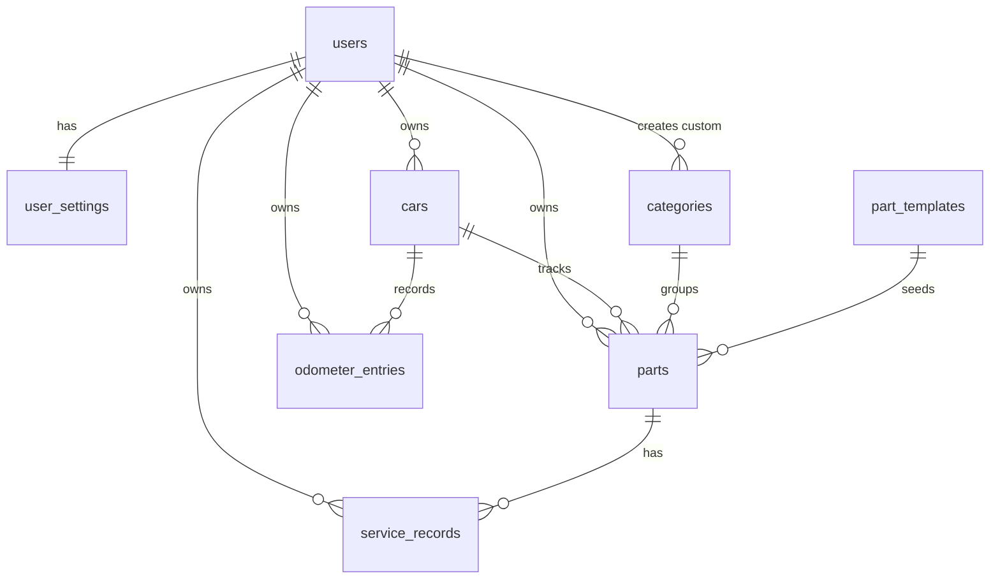

# 07 · Database Design Document

| Field | Value |
|---|---|
| Project | Car Maintenance Tracker (working title, OQ-05) |
| Version | 0.5 (approved 2026-11-01) |
| Date | 2026-11-01 |
| Owner | Salmen Ben Ammar |
| Related | [PVD](../01-discovery/01-product-vision.md), [PRD](../02-product-requirements/02-prd.md), [SRS](../03-technical-specifications/03-srs.md), [README](../README.md) |

**Conventions.** `FR-xxx` and `NFR-xxx` come from the SRS, `BR-xx` and `D-xx` from the PRD and README. `DB-xx` is this document's schema label; every one maps to a confirmed decision in the README, `D-33` onward (§14.1). Table and column names are the canonical names used by document 08 (API) and the code.

**Scope.** This document defines the logical database: tables, columns, types, constraints, indexes, derived values, and the synchronization contract that sits on top of them. The *logical* schema is backend-neutral; the *device DDL* shown here is SQLite, because SQLite is the confirmed working copy (D-02). The *cloud* is one shared PostgreSQL database in Supabase (D-03, D-58), and its DDL is in §5.2. Engine choice and library selection are settled in the TRD; network endpoints in document 08; the sync engine's internal protocol in document 06.

---

## 1. Design principles

| ID | Principle | Basis |
|---|---|---|
| DB-01 | Status is derived on read and never stored. Only the facts the owner entered are persisted. | D-33, FR-046 |
| DB-02 | Nothing is hard-deleted in normal use. Hiding and deleting are soft; a custom part's history is soft-deleted with it. A hidden part records **why** it is hidden, so a profile change can restore only what it hid. | D-34, FR-035, AC-17 |
| DB-03 | Conflict order is deterministic: the latest `updated_at` wins, and the device that wrote it breaks a tie. | D-35, FR-103 |
| DB-04 | The schema is the same on device and in the cloud, and the same for one user or many: `user_id` is always present on user rows. | D-36, FR-102 |
| DB-05 | Template values are copied into a part at creation and never re-applied; a seed update never rewrites a user's rows. | D-37, NFR-081, BR-14 |
| DB-06 | Money is stored as integer minor units with an ISO-4217 code, never as a float. | D-38, BR-18 |
| DB-07 | Cross-row rules (a mileage that may not decrease, a service km above the odometer) are enforced by the write path, not by triggers, because a merge can legitimately deliver rows out of order. | D-39, BR-01, BR-07 |
| DB-08 | Every syncable row carries the same envelope: UUID key, creation time, update time, deletion time, and the device that wrote the version. `users.id` is the exception: it is the login provider's subject. | D-40, FR-106 |
| DB-09 | The current odometer is never stored; it is `MAX(value_km)` before and after a merge. Units and miles are display concerns. | D-41, BR-01, BR-11 |
| DB-15 | Reference tables are **not synced**. They are seeded by migration on every database; only custom categories travel through sync. | D-47, NFR-081, FR-102 |
| DB-16 | A part created from a template gets a deterministic key, `carId:templateCode`, so two devices that create the same default parts offline converge on one row instead of duplicating them. | D-48, FR-031 |

IDs match §14.1, which is the full list and the authority; this table repeats only the principles that shape the schema.

---

## 2. Conventions

| Concern | Representation | Rule |
|---|---|---|
| Keys | `TEXT` | UUID v4 for rows the app creates, `users.id` is the provider subject, system reference rows use their stable `code`, template-derived parts use `carId:templateCode` (DB-08, DB-15, DB-16). Never reused. |
| Calendar dates | `TEXT` `YYYY-MM-DD` | Local date, no time zone (D-29). Never a timestamp. |
| Sync timestamps | `TEXT` | UTC ISO-8601 with milliseconds and a `Z` suffix: `2026-11-01T18:04:12.345Z`. |
| Cloud sequence | `bigint` | `sync_seq`, assigned by the cloud push function on every applied write; it is the pull order, never a user-visible value (§5.2, §9). |
| Whole numbers | `INTEGER` | Odometer 0 to 9,999,999 km (A-03). Months 1 to 240. |
| Booleans | `INTEGER` | `0` or `1`, with `CHECK (col IN (0,1))`. Never `NULL`. |
| Enumerations | `TEXT` | Closed list, enforced by `CHECK`. Values are lowercase snake_case. |
| Money | `INTEGER` minor units + `TEXT` ISO-4217 code | `cost_minor` with `cost_currency` (DB-06). No floating point. |
| "Unknown" | `NULL` | Never `0`, `''`, or a sentinel date. `service_km` and `service_date` are independently nullable **on baseline records only** (D-32, BR-20, DB-19). |
| User-visible text | `TEXT` on the row | Category and template names are stored English text; translation arrives as a lookup table in Release 2 (NFR-070, D-16). |

**Envelope columns.** Present on the synced tables only: `users`, `user_settings`, `cars`, `categories` (custom rows), `parts`, `odometer_entries`, `service_records`. Absent from `part_templates` and from system categories, which never leave the device. `user_settings` is keyed by `user_id` instead of `id`.

| Column | Type | Null | Meaning |
|---|---|---|---|
| `id` | TEXT | no | Primary key (see the key rule above) |
| `created_at` | TEXT | no | UTC, set on insert, never changed |
| `updated_at` | TEXT | no | UTC, set on every write; conflict order (DB-03) |
| `deleted_at` | TEXT | yes | UTC soft-delete time; `NULL` while the row exists |
| `origin_device_id` | TEXT | no | UUID of the device that wrote this version; conflict tie-break (DB-03) |

FK columns that reference a user's own data are declared `REFERENCES`. Deletes are soft, so no cascade is used; the write path soft-deletes children explicitly (DB-02).

---

## 3. Entity overview



System categories (`user_id IS NULL`) and `part_templates` are local reference data: seeded on every database, never synced, never owned by a user (DB-15).

`user_id` is redundant on `parts`, `odometer_entries`, and `service_records` (it is reachable through `cars`). It is kept deliberately: it makes per-user export, row-level security in the Supabase fallback, and account deletion a single-table operation instead of a join (DB-04).

---

## 4. Table definitions

### 4.1 `users`

A local mirror of the authenticated identity. Credentials and passwords never enter this database (NFR-024).

| Column | Type | Null | Default | Notes |
|---|---|---|---|---|
| `id` | TEXT | no | | Authentication subject from the provider. **Not** a UUID (DB-08 exception) |
| `email` | TEXT | no | | Cached for Settings (FR-110); refreshed on sign-in |
| `created_at` | TEXT | no | | |
| `updated_at` | TEXT | no | | |
| `deleted_at` | TEXT | yes | `NULL` | Account deletion (Release 2, FR-140) |
| `origin_device_id` | TEXT | no | | |

Primary key: `id`.

### 4.2 `user_settings`

One row per user. Missing row = defaults; the app inserts it on first run.

| Column | Type | Null | Default | Constraint |
|---|---|---|---|---|
| `user_id` | TEXT | no | | PK, `REFERENCES users(id)` |
| `reminder_enabled` | INTEGER | no | `1` | `IN (0,1)` (FR-083) |
| `reminder_time` | TEXT | no | `'20:00'` | `GLOB '[0-2][0-9]:[0-5][0-9]' AND BETWEEN '00:00' AND '23:59'` (A-08) |
| `currency_code` | TEXT | no | | Three uppercase letters; ISO 4217 (A-12, D-29) |
| `created_at` | TEXT | no | | |
| `updated_at` | TEXT | no | | |
| `deleted_at` | TEXT | yes | `NULL` | |
| `origin_device_id` | TEXT | no | | |

Distance unit and locale are Release 2 settings and are added by migration; storing a value that has no behaviour yet is noise (DB-14).

### 4.3 `cars`

| Column | Type | Null | Default | Constraint |
|---|---|---|---|---|
| `id` | TEXT | no | | PK, UUID v4 |
| `user_id` | TEXT | no | | `REFERENCES users(id)` |
| `name` | TEXT | no | | 1 to 60 characters after trim (FR-010) |
| `fuel_type` | TEXT | no | | `IN ('petrol','diesel')` (D-15) |
| `timing_drive` | TEXT | no | | `IN ('belt','chain')` |
| `gearbox` | TEXT | no | | `IN ('manual','automatic')` |
| `has_dpf` | INTEGER | no | `0` | `IN (0,1)`, and `fuel_type = 'diesel' OR has_dpf = 0` |
| `created_at` | TEXT | no | | |
| `updated_at` | TEXT | no | | |
| `deleted_at` | TEXT | yes | `NULL` | |
| `origin_device_id` | TEXT | no | | |

No `current_odometer` column: the current odometer is `MAX(value_km)` over live `odometer_entries` (BR-01, DB-09, DB-18).

The table also carries `UNIQUE (id, user_id)`. It is redundant with the primary key and exists only so child tables can hold a composite `(car_id, user_id)` foreign key that can never point at another owner's car after a bad merge (DB-26).

### 4.4 `categories`

Two kinds of row share the table. **System** rows are seeded, have `user_id IS NULL`, use their `code` as `id`, and are never synced. **Custom** rows (Release 2, A-11) carry the owner's `user_id`, a UUID, and the full envelope.

| Column | Type | Null | Default | Constraint |
|---|---|---|---|---|
| `id` | TEXT | no | | PK. System rows: the `code`. Custom rows: UUID v4 |
| `user_id` | TEXT | yes | `NULL` | `NULL` = shipped; otherwise `REFERENCES users(id)` |
| `code` | TEXT | no | | Stable identifier: `engine`, `filters`, … |
| `name` | TEXT | no | | Display name, English in Release 1 |
| `sort_order` | INTEGER | no | | 1 to 9 for system rows |
| `created_at` | TEXT | no | | |
| `updated_at` | TEXT | no | | Seed time for system rows |
| `deleted_at` | TEXT | yes | `NULL` | Custom rows only |
| `origin_device_id` | TEXT | yes | `NULL` | `NULL` for system rows (DB-15) |

Checks:

```sql
CHECK ((user_id IS NULL) = (origin_device_id IS NULL)),   -- system rows are never synced
CHECK (user_id IS NOT NULL OR id = code),                 -- system rows are keyed by their code
CHECK (user_id IS NOT NULL OR deleted_at IS NULL)          -- system rows are never deleted
```

Indexes: `UNIQUE (code) WHERE user_id IS NULL`; `UNIQUE (user_id, code) WHERE user_id IS NOT NULL`.

Deleting a custom category is a Release 2 action and is blocked while it still contains live parts: the owner moves or deletes them first (OQ-11). Reassigning parts silently would change what the owner sees.

### 4.5 `part_templates`

The default catalog of PRD Appendix A, as data (FR-030, NFR-081). Local reference data: seeded on every database, never synced, never joined to a user. The primary key is the stable `code`.

| Column | Type | Null | Default | Constraint |
|---|---|---|---|---|
| `code` | TEXT | no | | PK; stable across releases |
| `category_id` | TEXT | no | | `REFERENCES categories(id)`; a system category |
| `name` | TEXT | no | | English display name |
| `fuel_type` | TEXT | yes | `NULL` | `IN ('petrol','diesel')`; `NULL` = both |
| `timing_drive` | TEXT | yes | `NULL` | `IN ('belt','chain')`; `NULL` = either |
| `requires_dpf` | INTEGER | no | `0` | `IN (0,1)` |
| `interval_type` | TEXT | no | | `IN ('distance','time','both','condition')` |
| `distance_km` | INTEGER | yes | `NULL` | `> 0`; `NULL` = owner must set it (BR-12) |
| `months` | INTEGER | yes | `NULL` | `> 0`; `NULL` = owner must set it |
| `inspection_months` | INTEGER | yes | `NULL` | `BETWEEN 1 AND 60`; set on condition rows only (A-09) |
| `sort_order` | INTEGER | no | | Display order inside the category |
| `template_version` | INTEGER | no | | Version that introduced or last changed the row |
| `retired_at` | TEXT | yes | `NULL` | Local marker; retired templates stop being offered |

Interval consistency:

```sql
CHECK (
  (interval_type = 'distance'  AND months IS NULL) OR
  (interval_type = 'time'      AND distance_km IS NULL) OR
  (interval_type = 'both') OR
  (interval_type = 'condition' AND distance_km IS NULL AND months IS NULL
                               AND inspection_months IS NOT NULL)
),
CHECK (interval_type = 'condition' OR inspection_months IS NULL)
```

No timestamps and no envelope: the seed version is tracked by `schema_migrations`, and a template is never merged. Retiring a template never touches existing parts, because a part copies its values at creation (DB-05).

### 4.6 `parts`

One row per tracked part of a car, default or custom. Default and custom parts are the same shape (BR-14); `template_code` records provenance and makes the key deterministic.

| Column | Type | Null | Default | Constraint |
|---|---|---|---|---|
| `id` | TEXT | no | | PK. Template part: `carId:templateCode`. Custom part: UUID v4 |
| `user_id` | TEXT | no | | `REFERENCES users(id)` |
| `car_id` | TEXT | no | | `REFERENCES cars(id, user_id)` |
| `category_id` | TEXT | no | | `REFERENCES categories(id)`; plain key, system categories have no `user_id` |
| `template_code` | TEXT | yes | `NULL` | `REFERENCES part_templates(code)`; `NULL` = custom part |
| `name` | TEXT | no | | Copied from the template at creation, editable (FR-034) |
| `interval_type` | TEXT | no | | `IN ('distance','time','both','condition')` |
| `distance_km` | INTEGER | yes | `NULL` | `BETWEEN 1 AND 9999999`; `NULL` = not set yet |
| `months` | INTEGER | yes | `NULL` | `BETWEEN 1 AND 240`; `NULL` = not set yet |
| `inspection_months` | INTEGER | yes | `NULL` | `BETWEEN 1 AND 60`; required for `condition`, copied from the template (A-09) |
| `include_in_reminders` | INTEGER | no | `1` | `IN (0,1)`; applies to every part type (DB-17) |
| `hidden_by` | TEXT | yes | `NULL` | `IN ('user','profile')`; `NULL` = visible (DB-02) |
| `sort_order` | INTEGER | no | `0` | Copied from the template; custom parts append |
| `created_at` | TEXT | no | | |
| `updated_at` | TEXT | no | | |
| `deleted_at` | TEXT | yes | `NULL` | |
| `origin_device_id` | TEXT | no | | |

Additional checks:

```sql
CHECK (template_code IS NULL OR id = car_id || ':' || template_code),  -- merge-safe key (DB-16)
CHECK (interval_type <> 'distance' OR months IS NULL),
CHECK (interval_type <> 'time' OR distance_km IS NULL),
CHECK (interval_type <> 'condition' OR (inspection_months IS NOT NULL
                                        AND distance_km IS NULL
                                        AND months IS NULL)),
CHECK (interval_type = 'condition' OR inspection_months IS NULL),
CHECK (hidden_by IS NULL OR template_code IS NOT NULL)   -- custom parts are deleted, not hidden
```

Indexes: `(car_id) WHERE deleted_at IS NULL`; `(car_id, category_id, sort_order)`;
`UNIQUE (car_id, template_code) WHERE template_code IS NOT NULL`; `UNIQUE (id, user_id)`, for the composite key `service_records` needs (DB-26).

`include_in_reminders` is the setting the SRS calls the part's "alert setting" (FR-090). It is named for what it actually controls: whether the part appears in the daily reminder's inspection, due, and overdue lines (FR-082), which applies to distance-only and condition-based parts too. **It is on by default for every part** (A-06, revised in v0.4), because a part the owner never configured must still be reported when it is overdue; the owner turns it off per part. Scheduling a separate due-date notification still requires a time interval (FR-091).

`hidden_by` distinguishes the two ways a part can disappear: the owner hid it (`user`) and it stays hidden, or a car-profile change hid it (`profile`) and switching the profile back restores it. A profile change sets `'profile'` only where the column is `NULL`; a part the owner hid keeps `'user'` (D-34). Re-adding through "+ Add part" clears the column. A custom part is never hidden (FR-035).

### 4.7 `odometer_entries`

| Column | Type | Null | Default | Constraint |
|---|---|---|---|---|
| `id` | TEXT | no | | PK, UUID v4 |
| `user_id` | TEXT | no | | `REFERENCES users(id)` |
| `car_id` | TEXT | no | | `REFERENCES cars(id, user_id)` |
| `value_km` | INTEGER | no | | `BETWEEN 0 AND 9999999` (A-03) |
| `entry_date` | TEXT | no | | `GLOB '[0-9][0-9][0-9][0-9]-[0-9][0-9]-[0-9][0-9]'` and `date(entry_date) = entry_date` (D-29) |
| `created_at` | TEXT | no | | |
| `updated_at` | TEXT | no | | |
| `deleted_at` | TEXT | yes | `NULL` | |
| `origin_device_id` | TEXT | no | | |

Index: `(car_id, value_km DESC, entry_date DESC, created_at DESC) WHERE deleted_at IS NULL`.

**Ordering (DB-18).** Entries are ordered by `value_km DESC`, then `entry_date DESC`, then `created_at DESC`, then `id`. The first row in that order is "the latest entry"; equal values are allowed and never ambiguous.

**What may be edited or deleted.** Only the latest entry, after confirmation (FR-024). The guard also refuses an edit or deletion that would leave a live service record above the resulting odometer: the new maximum must be at least every live `service_records.service_km`. The last remaining entry cannot be deleted, because the car always needs a current odometer.

**"Updated today"** means at least one live entry with `entry_date` equal to today's local date, whatever its value. That is the condition that skips today's reminder (BR-09, FR-081).

**Equal value.** Entering a value equal to the current maximum is accepted and changes nothing observable (A-02); it creates a new row, which the ordering above handles. The alternative, silently discarding the entry, would hide the user's action.

### 4.8 `service_records`

Replacements, baselines, and inspections. One table, not two (DB-11): they share history position, timestamps, and sync; only the anchors and the cost differ, and the filter is one `kind = …` predicate.

| Column | Type | Null | Default | Constraint |
|---|---|---|---|---|
| `id` | TEXT | no | | PK, UUID v4 |
| `user_id` | TEXT | no | | `REFERENCES users(id)` |
| `car_id` | TEXT | no | | `REFERENCES cars(id, user_id)` |
| `part_id` | TEXT | no | | `REFERENCES parts(id, user_id)` |
| `kind` | TEXT | no | `'service'` | `IN ('service','inspection')` |
| `service_km` | INTEGER | yes | `NULL` | `BETWEEN 0 AND 9999999`; `NULL` = unknown (D-32) |
| `service_date` | TEXT | yes | `NULL` | Local calendar date; `NULL` = unknown (D-32) |
| `is_baseline` | INTEGER | no | `0` | `IN (0,1)`; setup and "all serviced today" (D-26) |
| `cost_minor` | INTEGER | yes | `NULL` | `>= 0`; minor units |
| `cost_currency` | TEXT | yes | `NULL` | Three uppercase letters, ISO 4217 (D-29) |
| `notes` | TEXT | yes | `NULL` | |
| `created_at` | TEXT | no | | |
| `updated_at` | TEXT | no | | |
| `deleted_at` | TEXT | yes | `NULL` | |
| `origin_device_id` | TEXT | no | | |

Additional checks:

```sql
CHECK (cost_minor IS NULL OR cost_currency IS NOT NULL),
CHECK (cost_minor IS NULL OR kind = 'service'),                  -- inspections carry no cost
CHECK (is_baseline = 0 OR kind = 'service'),
CHECK (kind <> 'inspection' OR (service_date IS NOT NULL AND service_km IS NULL)),
-- D-12: a replacement needs both anchors; only a baseline may omit one (DB-19)
CHECK (kind <> 'service' OR is_baseline = 1
       OR (service_km IS NOT NULL AND service_date IS NOT NULL)),
CHECK (kind <> 'service' OR is_baseline = 0
       OR service_km IS NOT NULL OR service_date IS NOT NULL),
CHECK (service_date IS NULL
       OR (service_date GLOB '[0-9][0-9][0-9][0-9]-[0-9][0-9]-[0-9][0-9]'
           AND date(service_date) = service_date))
```

The two baseline checks above keep D-32 representable without weakening D-12: a normal replacement always has km and date, while a setup or bulk baseline may carry only one of them (access control on the write path is not needed, the constraint is enough).

Indexes: `(part_id, service_date DESC, service_km DESC) WHERE deleted_at IS NULL`; `(car_id, service_date DESC)`.

### 4.9 `schema_migrations`

Device-local and cloud-local; never synced.

| Column | Type | Null | Constraint |
|---|---|---|---|
| `version` | INTEGER | no | PK, monotonically increasing |
| `applied_at` | TEXT | no | UTC timestamp |

### 4.10 Adapter-local tables (device only)

Never synced, never in the cloud. Document 07 §9 assigns sync bookkeeping to the adapter; these are the two tables it needs. The app creates them in the first migration.

| Table | Columns | Purpose |
|---|---|---|
| `local_meta` | `key` TEXT PK, `value` TEXT | `device_id`, `clock_offset_ms`, `last_user_id`, `pull_cursor`, `cloud_schema_version`, `conflicts_pending`, `notifications_built_for` |
| `sync_dirty` | `table_name` TEXT, `row_id` TEXT, `loaded_updated_at` TEXT, PK `(table_name, row_id)` | Rows changed locally and not yet acknowledged by a push |

`loaded_updated_at` is compared after each push: a row whose current `updated_at` still matches it is cleared from `sync_dirty`; a row changed while the push was in flight stays queued. Resetting app data empties both tables and generates a new `device_id`.

`conflicts_pending` holds the conflict list that the next home screen turns into a notice, stored whole so the notice can name the affected parts:

```json
[{"table":"parts","id":"car-1:engine_oil","label":"Engine oil"}]
```

It is written by the pull apply, cleared when the notice is shown, and never capped: the dataset is small (a merge touching every part is 17 rows), so capping would only hide the tail. The screen truncates the display. `notifications_built_for` holds the local date (`YYYY-MM-DD`) of the last rebuild, which the day-rollover check compares with today.

---

## 5. Physical settings

### 5.1 Device (SQLite)

| Setting | Value | Reason |
|---|---|---|
| `PRAGMA foreign_keys` | `ON` | References are real; sync writes rely on them being satisfiable |
| `PRAGMA journal_mode` | `WAL` | Concurrent reads during a write (NFR-001) |
| `PRAGMA busy_timeout` | `5000` | Avoid spurious failures during notification rebuild |
| Value storage | TEXT / INTEGER only | No `REAL` anywhere, so no float drift |

The DDL above is SQLite. `GLOB` and the `date()` check are the two constructs that do not survive translation.

### 5.2 Cloud (PostgreSQL)

Supabase was selected on 2026-11-01 (D-03 amended), so the cloud is PostgreSQL and the schema below is authoritative for it. It is the same model as §4, with four differences:

| Difference | Rule |
|---|---|
| Isolation | One shared database. Every synced table carries `user_id` plus a row-level security policy `user_id = auth.uid()::text` (DB-22). No per-user databases. |
| Ordering | Every synced row carries `sync_seq bigint` from one global sequence. It is the pull cursor; `updated_at` is never one (DB-23). |
| Write surface | Clients hold `select` only. All writes go through `push_rows`, all reads through `pull_rows` (DB-24). |
| Calendar dates | Native `date` columns instead of `text`. PostgreSQL validates leap days without a check, and JSON still serializes them as `YYYY-MM-DD`, so D-29 holds. Keys and timestamps stay `text`. |

Ids stay `text` (D-40); writing `user_id = auth.uid()::text` keeps that rule without changing a column type. Foreign keys are `DEFERRABLE INITIALLY DEFERRED` so a pull applies parent-first in one transaction regardless of row order.

```sql
create sequence sync_seq_seq;

create table users (
  id               text primary key,            -- auth.uid()::text
  email            text not null,
  created_at       text not null,
  updated_at       text not null,
  deleted_at       text,
  origin_device_id text not null,
  sync_seq         bigint not null default 0
);

create table user_settings (
  user_id          text primary key references users(id) deferrable initially deferred,
  reminder_enabled smallint not null default 1 check (reminder_enabled in (0,1)),
  reminder_time    text not null default '20:00'
                   check (reminder_time ~ '^([01][0-9]|2[0-3]):[0-5][0-9]$'),
  currency_code    text not null check (currency_code ~ '^[A-Z]{3}$'),
  created_at       text not null,
  updated_at       text not null,
  deleted_at       text,
  origin_device_id text not null,
  sync_seq         bigint not null default 0
);

create table cars (
  id               text primary key,
  user_id          text not null references users(id) deferrable initially deferred,
  name             text not null check (length(btrim(name)) between 1 and 60),
  fuel_type        text not null check (fuel_type in ('petrol','diesel')),
  timing_drive     text not null check (timing_drive in ('belt','chain')),
  gearbox          text not null check (gearbox in ('manual','automatic')),
  has_dpf          smallint not null default 0 check (has_dpf in (0,1)),
  created_at       text not null,
  updated_at       text not null,
  deleted_at       text,
  origin_device_id text not null,
  sync_seq         bigint not null default 0,
  unique (id, user_id),
  check (fuel_type = 'diesel' or has_dpf = 0)
);

create table categories (
  id               text primary key,
  user_id          text references users(id) deferrable initially deferred,
  code             text not null,
  name             text not null,
  sort_order       integer not null,
  created_at       text not null,
  updated_at       text not null,
  deleted_at       text,
  origin_device_id text,
  sync_seq         bigint not null default 0,
  check ((user_id is null) = (origin_device_id is null)),
  check (user_id is not null or id = code),
  check (user_id is not null or deleted_at is null)
);

create table part_templates (
  code              text primary key,
  category_id       text not null references categories(id) deferrable initially deferred,
  name              text not null,
  fuel_type         text check (fuel_type in ('petrol','diesel')),
  timing_drive      text check (timing_drive in ('belt','chain')),
  requires_dpf      smallint not null default 0 check (requires_dpf in (0,1)),
  interval_type     text not null check (interval_type in ('distance','time','both','condition')),
  distance_km       integer check (distance_km > 0),
  months            integer check (months > 0),
  inspection_months integer check (inspection_months between 1 and 60),
  sort_order        integer not null,
  template_version  integer not null,
  retired_at        text,
  check (
    (interval_type = 'distance'  and months is null) or
    (interval_type = 'time'      and distance_km is null) or
    (interval_type = 'both') or
    (interval_type = 'condition' and distance_km is null and months is null
                                 and inspection_months is not null)
  ),
  check (interval_type = 'condition' or inspection_months is null)
);

create table parts (
  id                   text primary key,
  user_id              text not null references users(id) deferrable initially deferred,
  car_id               text not null references cars(id, user_id) deferrable initially deferred,
  category_id          text not null references categories(id) deferrable initially deferred,
  template_code        text references part_templates(code) deferrable initially deferred,
  name                 text not null,
  interval_type        text not null check (interval_type in ('distance','time','both','condition')),
  distance_km          integer check (distance_km between 1 and 9999999),
  months               integer check (months between 1 and 240),
  inspection_months    integer check (inspection_months between 1 and 60),
  include_in_reminders smallint not null default 1 check (include_in_reminders in (0,1)),
  hidden_by            text check (hidden_by in ('user','profile')),
  sort_order           integer not null default 0,
  created_at           text not null,
  updated_at           text not null,
  deleted_at           text,
  origin_device_id     text not null,
  sync_seq             bigint not null default 0,
  unique (id, user_id),
  check (template_code is null or id = car_id || ':' || template_code),
  check (interval_type <> 'distance'  or months is null),
  check (interval_type <> 'time'      or distance_km is null),
  check (interval_type <> 'condition' or (inspection_months is not null
                                          and distance_km is null
                                          and months is null)),
  check (interval_type = 'condition' or inspection_months is null),
  check (hidden_by is null or template_code is not null)
);

create table odometer_entries (
  id               text primary key,
  user_id          text not null references users(id) deferrable initially deferred,
  car_id           text not null references cars(id, user_id) deferrable initially deferred,
  value_km         integer not null check (value_km between 0 and 9999999),
  entry_date       date not null,
  created_at       text not null,
  updated_at       text not null,
  deleted_at       text,
  origin_device_id text not null,
  sync_seq         bigint not null default 0
);

create table service_records (
  id               text primary key,
  user_id          text not null references users(id) deferrable initially deferred,
  car_id           text not null references cars(id, user_id) deferrable initially deferred,
  part_id          text not null references parts(id, user_id) deferrable initially deferred,
  kind             text not null default 'service' check (kind in ('service','inspection')),
  service_km       integer check (service_km between 0 and 9999999),
  service_date     date,
  is_baseline      smallint not null default 0 check (is_baseline in (0,1)),
  cost_minor       integer check (cost_minor >= 0),
  cost_currency    text check (cost_currency ~ '^[A-Z]{3}$'),
  notes            text,
  created_at       text not null,
  updated_at       text not null,
  deleted_at       text,
  origin_device_id text not null,
  sync_seq         bigint not null default 0,
  check (cost_minor is null or cost_currency is not null),
  check (cost_minor is null or kind = 'service'),
  check (is_baseline = 0 or kind = 'service'),
  check (kind <> 'inspection' or (service_date is not null and service_km is null)),
  check (kind <> 'service' or is_baseline = 1
         or (service_km is not null and service_date is not null)),
  check (kind <> 'service' or is_baseline = 0
         or service_km is not null or service_date is not null)
);

create table schema_migrations (
  version    integer primary key,
  applied_at timestamptz not null default now()
);
```

Every index of §4 is recreated unchanged, plus one per synced table for the pull:

```sql
create index cars_sync_seq             on cars             (user_id, sync_seq);
create index user_settings_sync_seq    on user_settings    (user_id, sync_seq);
create index parts_sync_seq            on parts            (user_id, sync_seq);
create index odometer_entries_sync_seq on odometer_entries (user_id, sync_seq);
create index service_records_sync_seq  on service_records  (user_id, sync_seq);
create index categories_sync_seq       on categories       (user_id, sync_seq) where user_id is not null;
create index users_sync_seq            on users            (sync_seq);
```

**Isolation and write surface.** RLS is on for every table. Reference rows are readable by all authenticated users and writable by none; `users` is scoped to its own id.

```sql
alter table users            enable row level security;
alter table user_settings    enable row level security;
alter table cars             enable row level security;
alter table categories       enable row level security;
alter table part_templates   enable row level security;
alter table parts            enable row level security;
alter table odometer_entries enable row level security;
alter table service_records  enable row level security;

create policy users_select on users for select to authenticated
  using (id = auth.uid()::text);
create policy user_settings_select on user_settings for select to authenticated
  using (user_id = auth.uid()::text);
create policy cars_select on cars for select to authenticated
  using (user_id = auth.uid()::text);
create policy parts_select on parts for select to authenticated
  using (user_id = auth.uid()::text);
create policy odometer_entries_select on odometer_entries for select to authenticated
  using (user_id = auth.uid()::text);
create policy service_records_select on service_records for select to authenticated
  using (user_id = auth.uid()::text);
create policy categories_select on categories for select to authenticated
  using (user_id is null or user_id = auth.uid()::text);
create policy part_templates_select on part_templates for select to authenticated
  using (true);

revoke insert, update, delete on all tables in schema public from anon, authenticated;
grant select on users, user_settings, cars, categories, part_templates,
                parts, odometer_entries, service_records, schema_migrations
  to authenticated;
```

**The two functions.** These are the whole cloud write and read surface (DB-24). Their bodies live in `supabase/migrations`, with the code.

| Function | Mode | Input | Output |
|---|---|---|---|
| `push_rows(p_rows jsonb)` | `security definer`, `set search_path = public, pg_temp` | array of `{table, row}`, parent tables first | `{applied: [id], rejected: [id], server_now}` |
| `pull_rows(p_cursor bigint)` | invoker, so RLS scopes the read | last cursor | `{rows: [{table, row}], max_seq, server_now, schema_version}` |

`push_rows` rules, all in one transaction:

1. Whitelist the seven table names; build every statement with `format('%I')`, never with client text.
2. Set `user_id` from `auth.uid()::text` and reject any row that carries a different value. **This check is the security boundary**: the function runs as definer and therefore bypasses RLS.
3. Upsert conditionally, stamping `sync_seq = nextval('sync_seq_seq')` only when the row is applied:

```sql
insert into parts (id, user_id, /* ... */ updated_at, origin_device_id, sync_seq)
values (?, ?, /* ... */ ?, ?, nextval('sync_seq_seq'))
on conflict (id) do update set /* all columns = excluded.* */,
      sync_seq = nextval('sync_seq_seq')
where excluded.updated_at > parts.updated_at
   or (excluded.updated_at = parts.updated_at
       and excluded.origin_device_id > parts.origin_device_id)
returning id;
```

4. Return the ids the statement actually returned as `applied`; everything else is `rejected`. Replay is a no-op because a rejected row changes nothing and a repeated applied row fails the predicate.

`pull_rows` returns every row with `sync_seq > p_cursor` for the caller, across the seven tables, with no paging: the whole dataset is about 1,200 rows (see §12), and paging by `sync_seq` breaks when a parent is updated past a page boundary. `schema_version` is `max(version)` from `schema_migrations`.

Device reference rows and cloud reference rows are both seeded by their own migration (DB-15), so they never sync and never conflict.

---

## 6. Derived values

Nothing in this section is stored. Each is computed by one function and is the only place its rule lives.

### 6.1 Current odometer

```
current_odometer_km(car) = MAX(value_km) for live odometer_entries of that car
```

This definition holds after a merge as well (D-31, BR-01). A merge can leave a service record above the current odometer when two devices edited history concurrently; the record is kept, and until the odometer catches up the part shows a remaining distance greater than its interval. The write guard in §4.7 only prevents the app from creating that state locally.

### 6.2 Active record of a part

The active service record is the greatest service date; ties go to the greatest km (D-25). Records whose date is unknown rank after every dated record — only baselines can be in that state (DB-19), so a dated record always takes over once it exists (DB-10).

```sql
SELECT id, service_km, service_date
FROM service_records
WHERE part_id = :part_id AND kind = 'service' AND deleted_at IS NULL
ORDER BY service_date IS NULL,
         service_date DESC,
         service_km IS NULL,
         service_km DESC
LIMIT 1;
```

The same ordering, applied to `kind = 'inspection'`, gives the last inspection (A-16).

### 6.3 Remaining distance and time

Let `I` be the distance interval and `M` the time interval in calendar months.

```
remaining_km   = I - (current_odometer_km - active.service_km)        when both are known
due_date       = addMonths(active.service_date, M)                    clamped to month end (D-30)
remaining_days = due_date - today
```

`addMonths` clamps: 31 Jan + 1 month = 28 or 29 Feb (BR-03, D-30).

### 6.4 Status precedence

Evaluated in this order; the first match wins (BR-05).

| Order | Status | Condition |
|---|---|---|
| 1 | Inspect | `interval_type = 'condition'` (FR-044) |
| 2 | Set interval | A required interval value is missing (DB-13) |
| 3 | Unknown | No active service record; a time-only part whose active date is `NULL`; or a distance-only part whose active `service_km` is `NULL` (BR-20) |
| 4 | Overdue | `remaining_km <= 0`, or `remaining_days <= 0` |
| 5 | Due soon | `remaining_km <= min(I / 2, 1000)`, or `remaining_days <= min(30, floor(days_between(service_date, due_date) / 2))` |
| 6 | OK | Otherwise |

The time threshold is computed in days on purpose (DB-21): a 1-month interval has about 30 days between service and due date, so its half is about 15 days. Working in whole months would round that half down to 0 and mark the part Due soon immediately after a replacement (D-22).

A part whose active date is `NULL` is judged on distance only: it can be Overdue or Due soon by distance, never by time (BR-20). Symmetrically, a record with no `service_km` has no distance side: a time-only part, and a `both` part in that state, are judged on time alone, and a distance-only part in that state is Unknown (BR-20).

### 6.5 Inspection due

```
anchor = max of: last inspection date, last service date, local date of the part's created_at
         (null dates ignored; if all three are null, the part is not due)
due    = today >= addMonths(anchor, inspection_months)
```

Counting from the latest service record as well as the last inspection means a replacement resets the inspection cycle (DB-20): brake pads replaced today are not "inspection due" the same day.

### 6.6 "Needs attention" ordering

Three groups, in this order: Overdue, inspection due, Due soon. Within Overdue, the most negative remaining value first; within inspection due and Due soon, the nearest due date or smallest remaining distance first (FR-047, D-27).

### 6.7 Cost totals

Sum `cost_minor` of live `kind = 'service'`, `is_baseline = 0` rows, grouped by `cost_currency`. Baseline rows are excluded (D-26); inspections carry no cost.

---

## 7. Reference queries

```sql
-- Current odometer
SELECT MAX(value_km) FROM odometer_entries
WHERE car_id = :car_id AND deleted_at IS NULL;

-- Latest entry (the only one that may be edited or deleted)
SELECT * FROM odometer_entries
WHERE car_id = :car_id AND deleted_at IS NULL
ORDER BY value_km DESC, entry_date DESC, created_at DESC, id DESC
LIMIT 1;

-- Was the mileage updated today? (skips today's reminder)
SELECT EXISTS (
  SELECT 1 FROM odometer_entries
  WHERE car_id = :car_id AND deleted_at IS NULL AND entry_date = :today);

-- Home screen: live parts with their active service record and last inspection,
-- in category order (feeds §6.3 to §6.5)
SELECT p.id, p.name, p.category_id, p.interval_type, p.distance_km, p.months,
       p.inspection_months, p.include_in_reminders, p.created_at,
       a.service_km, a.service_date, i.service_date AS last_inspection_date
FROM parts p
JOIN categories c ON c.id = p.category_id
LEFT JOIN service_records a ON a.id = (
  SELECT s.id FROM service_records s
  WHERE s.part_id = p.id AND s.kind = 'service' AND s.deleted_at IS NULL
  ORDER BY s.service_date IS NULL, s.service_date DESC,
           s.service_km IS NULL, s.service_km DESC
  LIMIT 1)
LEFT JOIN service_records i ON i.id = (
  SELECT s.id FROM service_records s
  WHERE s.part_id = p.id AND s.kind = 'inspection' AND s.deleted_at IS NULL
  ORDER BY s.service_date DESC
  LIMIT 1)
WHERE p.car_id = :car_id AND p.deleted_at IS NULL AND p.hidden_by IS NULL
ORDER BY c.sort_order, p.sort_order, p.name;

-- Service history of a part, newest first
SELECT * FROM service_records
WHERE part_id = :part_id AND deleted_at IS NULL
ORDER BY service_date IS NULL, service_date DESC,
         service_km IS NULL, service_km DESC;

-- Cost total for a part or a car, per currency
SELECT cost_currency, SUM(cost_minor)
FROM service_records
WHERE part_id = :part_id AND deleted_at IS NULL
  AND kind = 'service' AND is_baseline = 0
GROUP BY cost_currency;
```

Status computation is not expressible as a query over one table because it depends on today's local date; it runs in the app layer once per home-screen load (NFR-002).

---

## 8. Seed data

Seeds run from a migration on every database (DB-15). System category IDs equal their codes; template IDs are their codes; neither is generated, so every install produces identical reference rows.

### 8.1 Categories

| `code` = `id` | `name` | `sort_order` |
|---|---|---|
| `engine` | Engine | 1 |
| `filters` | Filters | 2 |
| `fuel` | Fuel | 3 |
| `brakes` | Brakes | 4 |
| `fluids` | Fluids | 5 |
| `tires` | Tires | 6 |
| `electrical` | Electrical | 7 |
| `visibility` | Visibility | 8 |
| `emissions` | Emissions | 9 |

### 8.2 Part templates (PRD Appendix A)

| `code` | Category | Name | Fuel | Drive | DPF | Type | km | months | Inspect months |
|---|---|---|---|---|---|---|---|---|---|
| `engine_oil` | engine | Engine oil | | | | both | 10000 | 12 | |
| `engine_oil_filter` | engine | Engine oil filter | | | | both | 10000 | 12 | |
| `spark_plugs` | engine | Spark plugs | petrol | | | distance | 30000 | | |
| `timing_belt` | engine | Timing belt | | belt | | both | | | |
| `accessory_belt` | engine | Drive/serpentine belt | | | | condition | | | 3 |
| `air_filter` | filters | Air filter | | | | distance | 15000 | | |
| `cabin_filter` | filters | Cabin filter | | | | both | 20000 | 12 | |
| `fuel_filter` | fuel | Fuel filter | diesel | | | distance | 30000 | | |
| `glow_plugs` | fuel | Glow plugs | diesel | | | distance | 120000 | | |
| `brake_fluid` | brakes | Brake fluid | | | | time | | 24 | |
| `brake_pads_discs` | brakes | Brake pads and discs | | | | condition | | | 3 |
| `coolant` | fluids | Coolant | | | | both | 100000 | 60 | |
| `gearbox_oil` | fluids | Transmission or gearbox oil | | | | distance | | | |
| `tire_rotation` | tires | Tire rotation | | | | distance | 10000 | | |
| `alignment` | tires | Replacement and alignment | | | | condition | | | 3 |
| `battery` | electrical | Battery | | | | time | | 48 | |
| `wiper_blades` | visibility | Wiper blades | | | | time | | 12 | |
| `dpf` | emissions | DPF | diesel | | yes | condition | | | 3 |

Blank cells are `NULL`. The fuel filter row is shown by default only for diesel; a petrol owner can add it through "+ Add part" (BR-13). Engine oil and oil filter are two rows with the same interval, as the PRD notes.

Default parts are created for a new car by selecting templates where `fuel_type IS NULL OR fuel_type = car.fuel_type`, `timing_drive IS NULL OR timing_drive = car.timing_drive`, and `requires_dpf = 0 OR car.has_dpf = 1` (FR-031, BR-13). Each new part gets `id = car_id || ':' || template_code` (DB-16).

---

## 9. Synchronization contract

| Topic | Rule |
|---|---|
| Scope | One user's rows only. Isolation is enforced by row-level security in PostgreSQL (`user_id = auth.uid()::text`), not by `WHERE user_id = ?` in the app (FR-102, NFR-021, DB-22). |
| Synced tables | `users`, `user_settings`, `cars`, custom `categories`, `parts`, `odometer_entries`, `service_records`. |
| Reference data | `part_templates` and system categories are never synced; the same idempotent seed migration runs on every database, device and cloud, so the rows are identical everywhere and no conflict can exist (DB-15). In the shared cloud database the system rows are readable by every authenticated user and writable by none (§5.2). |
| Duplicate defaults | Two devices that create default parts offline produce the same `parts.id`, so the merge updates one row instead of inserting two (DB-16). |
| Unit of sync | The row. A pull applies tables parent-first (`users`, `user_settings`, `cars`, `categories`, `parts`, `odometer_entries`, `service_records`) inside one transaction, with `PRAGMA defer_foreign_keys = ON` so an out-of-order batch still commits or rolls back as a whole; the cloud side uses `DEFERRABLE` keys for the same reason. |
| Cursor | The pull cursor is the greatest applied `sync_seq`. It is never `updated_at`, because a device that was offline can push rows older than what another device already pulled past (DB-23). |
| Push | One `push_rows` call per batch, one transaction, conditional upserts. The function is the only cloud writer; clients have no insert, update or delete grant (DB-24). |
| Pull | One `pull_rows` call returns every row above the cursor for the caller, with no paging. The client applies it parent-first, stores the returned `max_seq` as its new cursor in the same transaction, then rebuilds notifications and records `notifications_built_for`. |
| Conflict | Highest `updated_at` wins. If two versions carry the same `updated_at`, the lexicographically greater `origin_device_id` wins (DB-03). A losing local row that is still queued stays dirty and is pushed next pass; a pulled row that lost the comparison against the local row is not applied (AR-15). The losers are listed in `local_meta.conflicts_pending` for the next home-screen notice, and the list is never capped (DB-27). |
| Deletion | `deleted_at` is set; the row ships like any other and disappears from reads (BR-19). |
| Replay | Applying the same batch twice is a no-op: a row is written only when the incoming `(updated_at, origin_device_id)` is greater than the stored one. |
| Child deletion | Deleting a custom part stamps the same `updated_at` and `origin_device_id` on the part and on every one of its service records, in one local transaction (FR-035, AC-17). |
| Local date fields | Never converted. `entry_date` and `service_date` are calendar dates the owner typed (D-29). |
| Current odometer | Recomputed as `MAX(value_km)` after every pull, never merged as a scalar (DB-18). |
| Tombstone retention | Kept indefinitely in Release 1. Purging requires tracking every device's last-pull position; it is deferred until there is more than one active device or the store requires it. |

The app never blocks a local read or write on a valid token (D-28, BR-17). Sync bookkeeping (cursors, last pull) belongs to the sync adapter and is not stored in these tables.

---

## 10. Migrations

| Rule | Detail |
|---|---|
| Versioning | Numbered, forward-only files `NNNN_description.sql`; applied in order inside one transaction. |
| Tracking | `schema_migrations.version` (NFR-080). |
| Schema migrations | Device: applied by the app's runner. Cloud: applied by the operator with the Supabase CLI, never by the app (DB-25). |
| Compatibility | A cloud migration stays backward compatible with the previous app release for one version, because a sideloaded client can lag by up to the re-signing cycle. |
| Location | Device modules live with the app code; cloud files live in `supabase/migrations`. Both are forward-only and share the same numbering. |
| Seed migrations | Run on every database (device and per-user cloud), never on the sync path. They populate `categories` (system rows) and `part_templates`, and are idempotent: `ON CONFLICT(id) DO UPDATE` for system categories (their `id` is the code) and `ON CONFLICT(code) DO UPDATE` for templates (DB-15). |
| Existing parts | A changed template interval affects new cars only; an existing part keeps the interval the owner has (BR-14). |
| Downgrade | Not supported. Restore from backup. |

Retiring a template is a local seed change: set `retired_at`, keep the row so existing parts still resolve their `template_code`. The row stops being offered for new cars.

---

## 11. Data lifecycle

| Action | Effect |
|---|---|
| Hide a default part (owner) | `parts.hidden_by = 'user'`; history untouched (FR-035). |
| Hide a default part (profile change) | `parts.hidden_by = 'profile'` only where it is `NULL`; a part the owner hid keeps `'user'`; history untouched (FR-011, BR-13, D-34). |
| Change the profile back | Clear `hidden_by` only on rows set to `'profile'`; parts the owner hid stay hidden (OQ-07). |
| Re-add a hidden default part | Clear `hidden_by`; history returns with it (FR-036). Idempotent because the ID is deterministic. |
| Delete a custom part | Soft-delete the part and its service records in one transaction (FR-035). |
| Edit or delete a service record | Soft delete or in-place update; the active record is recomputed (FR-054, AC-18). |
| "All serviced today" | One baseline service record per part, km = current odometer, date = today (FR-062). For a condition-based part this also resets its inspection anchor (DB-20). |
| Export (Release 2) | JSON: one array per table filtered by `user_id`, envelope included; system reference rows are excluded because they are reseeded on restore. CSV: one file per table, dates as stored, money as `amount` + `currency` (FR-120). |
| Delete account (Release 2) | Operator step with the service-role key: delete the `auth.users` row and the user's rows in the cloud, then wipe the local database and sign out. The app cannot do it because clients hold no delete grant (FR-140, D-71). |
| Reset app data | Local wipe; the next sign-in restores from the cloud (FR-104). |

This implements D-34 (which closed OQ-07): the profile and the owner are recorded separately, so restoring a profile returns exactly the parts that profile took away, while a part the owner deliberately hid stays hidden. Re-adding any hidden part restores its history because the history was never deleted.

---

## 12. Capacity and performance

| Figure | Assumption | Consequence |
|---|---|---|
| Parts per car | Up to 17 defaults + a few custom, 100 is the design limit (NFR-002) | Home screen is one query plus in-memory status work |
| Odometer entries | 2 per month for 20 years = 480 | Index-only scan for the maximum |
| Service records | 17 parts × 2 per year × 20 years ≈ 680 | History is per part and indexed |
| Database size | Well under 5 MB | Backup and export are trivial |

Every read used by the home screen, the part detail, and the needs-attention list touches an index from §4 and returns at most 100 rows, so NFR-002 (500 ms after an odometer update) is met by the schema without caching.

---

## 13. Traceability

| Requirement | Tables |
|---|---|
| FR-001 to FR-006 (auth) | `users` (identity only; credentials stay with the provider) |
| FR-010 to FR-012 (car) | `cars` |
| FR-020 to FR-027 (odometer) | `odometer_entries`, §4.7 ordering and guard |
| FR-030 to FR-037 (parts, categories) | `categories`, `part_templates`, `parts` |
| FR-040 to FR-049 (status) | Derived from `parts`, `service_records`, `odometer_entries` (§6) |
| FR-050 to FR-056 (service records) | `service_records`, §4.8 checks |
| FR-060 to FR-063 (setup) | `service_records.is_baseline` |
| FR-080 to FR-094 (reminders, alerts) | `user_settings`, `parts.include_in_reminders`, `service_records`; no notification table (§6, D-24) |
| FR-100 to FR-106 (offline, sync) | Envelope columns, §9 |
| FR-110, FR-111 (settings) | `user_settings`, `service_records.cost_currency` |
| FR-120 (export) | All user tables (§11) |
| FR-140 (delete account) | `users` and every table via `user_id` (§11) |
| NFR-080 (versioned schema) | `schema_migrations` (§10) |
| NFR-081 (templates as data) | `part_templates`, seeded locally (DB-15) |
| NFR-082 (UUID keys, timestamps) | Envelope columns (§2), with the `users.id` and reference-row exceptions |
| BR-01 (odometer never decreases) | `odometer_entries`, enforced by the write path and the §4.7 guard |
| BR-05 (status list) | §6.4 |
| BR-08 (inspection) | `parts.inspection_months`, `service_records.kind = 'inspection'`, §6.5 |
| BR-16 (baseline) | `service_records.is_baseline`, §6.7 |
| BR-18 (dates, currency) | `entry_date`, `service_date`, `cost_currency` |
| BR-19 (conflicts) | §9 |
| BR-20 (independent anchors) | Nullable baselines, §6.3, DB-19 |

---

## 14. Decisions and open questions

### 14.1 Confirmed schema decisions

Approved by the owner on 2026-11-01. The README register is authoritative; the `DB-xx` column is the label used in this document. **DB-22 to DB-24 restate D-58 to D-60**, and DB-25 is D-73: they were added in v0.4 after the move to Supabase.

| DB | Decision | README |
|---|---|---|
| DB-01 | Status is derived on read; no status column. | D-33 |
| DB-02 | Hiding records its cause (`user` or `profile`); restoring a profile returns only profile-hidden parts, re-adding restores history. | D-34 |
| DB-03 | Conflict order is `updated_at`, then `origin_device_id`. | D-35 |
| DB-04 | `user_id` is stored on every user-owned table, including on per-user cloud databases. | D-36 |
| DB-05 | Template values are copied into parts and never re-applied. | D-37 |
| DB-06 | Cost is stored as integer minor units plus an ISO-4217 currency code. | D-38 |
| DB-07 | Cross-row validity is enforced by the write path, never by triggers. | D-39 |
| DB-08 | Primary keys are UUID v4 stored as `TEXT`. Exceptions: `users.id` is the provider subject, system rows use their code, template parts use `carId:templateCode`. | D-40 |
| DB-09 | The current odometer is never stored; it is `MAX(value_km)`, before and after a merge. | D-41 |
| DB-10 | Date-unknown service records rank after dated records when choosing the active record. | D-42 |
| DB-11 | Replacements and inspections share `service_records`, separated by `kind`. | D-43 |
| DB-12 | System categories are rows with `user_id IS NULL`; custom categories carry a `user_id`. | D-44 |
| DB-13 | "Set interval" means any required interval value is missing: `distance_km` for distance and both, `months` for time and both. | D-45 |
| DB-14 | Release 2 and 3 settings (distance unit, locale, warn-earlier thresholds) are added by migration, not pre-created. | D-46 |
| DB-15 | Reference tables are local: seeded by migration on every database, never synced. Only custom categories sync. | D-47 |
| DB-16 | A template-derived part's ID is `carId:templateCode`, enforced by a check, so concurrent offline creation converges. | D-48 |
| DB-17 | The per-part reminder flag is `include_in_reminders`, valid for every part type; separate alerts still need a time interval. | D-49 |
| DB-18 | Odometer order is value, then date, then creation time; "updated today" means a live entry dated today; edit and delete are blocked if a live service record would sit above the result. | D-50 |
| DB-19 | A replacement requires km and date; only a baseline record may omit either, and never both. | D-51 |
| DB-20 | Inspection due counts from the latest of the last inspection, the last service record, and part creation. | D-52 |
| DB-21 | The Due soon time threshold is `min(30, half the days between service date and due date)`. | D-53 |
| DB-22 | The cloud is one shared PostgreSQL database. Isolation is row-level security, `user_id = auth.uid()::text`; there are no per-user databases. | D-58 (implements D-03 amended, NFR-021) |
| DB-23 | Every synced row carries `sync_seq` from one global sequence, and the pull cursor is `sync_seq`. No `sync_log` table. | D-59 |
| DB-24 | Clients hold `select` only; `push_rows` and `pull_rows` are the entire write and read surface. | D-60 |
| DB-25 | Cloud migrations are applied by the operator with the Supabase CLI, never by the app, and stay backward compatible for one app release. | D-73 |
| DB-26 | Child tables reference their parent by `(parent_id, user_id)` against `UNIQUE (id, user_id)` on `cars` and `parts`. An orphan or a cross-owner reference therefore fails the transaction and holds the cursor instead of being repaired. `parts.category_id` stays a plain key because system categories have no `user_id`. | D-89 (implements AR-16) |
| DB-27 | The conflict notice payload is the whole list of `{table, id, label}` in `local_meta.conflicts_pending`, never a counter and never capped; the screen truncates the display. `local_meta.notifications_built_for` stores the date of the last rebuild. | D-86 (implements AR-13) |

### 14.2 Open questions

| ID | Question | Owner document |
|---|---|---|
| OQ-06 | Closed: see D-33. | Closed |
| OQ-07 | Closed: see D-34. | Closed |
| OQ-01 | Closed: Supabase selected (D-03, D-58). The logical schema is unchanged; §5.2 holds the PostgreSQL DDL, and isolation is row-level security rather than a per-user database. | Closed |
| OQ-11 | Should a custom category with live parts block deletion, or move its parts to "Uncategorized"? Proposed: block in Release 2. | UI/UX, Release 2 |

---

## 15. Change log

| Version | Date | Changes |
|---|---|---|
| 0.1 | 2026-11-01 | First version: nine tables, envelope and sync contract, derived status rules, seeds for Appendix A, migrations, lifecycle, traceability, proposed DB-01 to DB-14. |
| 0.2 | 2026-11-01 | Review fixes: reference tables are local and unsynced (DB-15); deterministic part IDs (DB-16); reminder flag applies to all part types (DB-17); odometer ordering, "updated today", and the edit/delete guard (DB-18); replacements require km and date (DB-19); inspection anchor includes replacements (DB-20); Due soon threshold in days (DB-21); hidden parts record their cause (`user`/`profile`); `users.id` and reference rows documented as key exceptions; SQLite DDL labelled as such; template `inspection_months` default removed; "all serviced today" defined for condition-based parts. Approved by the owner; DB-01 to DB-21 promoted to D-33 to D-53. |
| 0.3 | 2026-11-01 | Consistency pass: §1 DB-05/DB-09 aligned with §14.1 and the basis column cites the same decisions; profile hide keeps an owner hide; home query adds the last inspection; `cars.sort_order` removed; "18 defaults" corrected to 17; date-only baseline status defined; `service_date` format check; `inspection_months` restricted to condition rows; seed conflict targets fixed; DB-17 wording; OQ-06/OQ-07 closure wording. |
| 0.4 | 2026-11-01 | Supabase selected (D-03): §5 split into device and cloud; PostgreSQL schema added in §5.2 with `sync_seq`, RLS policies, read-only clients and the two sync functions; DB-22 to DB-25 proposed; cloud migrations are operator-applied and backward compatible (§10); account deletion is an operator step (§11); reference rows in the shared cloud are read-only. `include_in_reminders` now defaults to `1` for every part, so reminder lines cover distance-only and condition-based parts as BR-08, FR-082 and AC-10 require; A-06 and FR-090 were revised to match. Approved 2026-11-01; DB-22 to DB-24 map to D-58 to D-60 and DB-25 to D-73. |
| 0.5 | 2026-11-01 | Amendment after the architecture review. §4.10 stores the conflict list whole as `conflicts_pending` (JSON `{table, id, label}`) and adds `notifications_built_for`; the `conflicts_since_notice` counter is gone. DB-26 adds `UNIQUE (id, user_id)` on `cars` and `parts` and composite `(parent_id, user_id)` foreign keys on `parts`, `odometer_entries` and `service_records`, in §4 and §5.2 alike, so orphans and cross-owner references fail loudly instead of needing a repair rule. OQ-01 closed; the intro no longer treats PostgreSQL as a fallback. |
