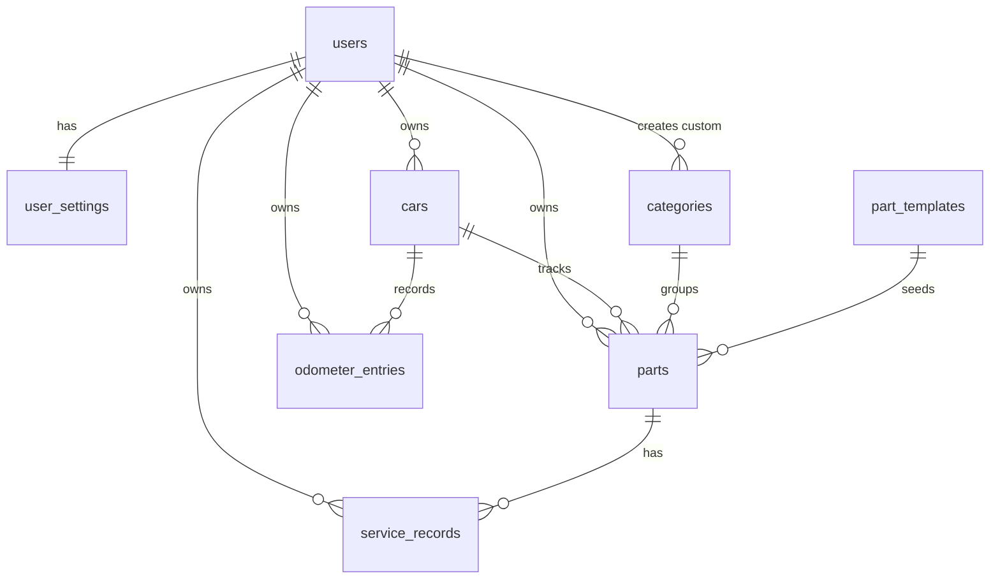

# DBD · Principles, conventions, entity overview

> Part of [07-database-design.md](../07-database-design.md). Sections: §1, §2, §3. Section numbers are unchanged, so references such as "doc 07 §5.2" still resolve.

## 1. Design principles

| ID | Principle | Basis |
|---|---|---|
| DB-01 | Status is derived on read and never stored. Only the facts the owner entered are persisted. | D-33, FR-046 |
| DB-02 | Nothing is hard-deleted in normal use. Hiding and deleting are soft; a custom part's history is soft-deleted with it. A hidden part records **why** it is hidden, so a profile change can restore only what it hid. | D-34, FR-035, AC-17 |
| DB-03 | Conflict order is deterministic: the latest `updated_at` wins, and the device that wrote it breaks a tie. | D-35, FR-103 |
| DB-04 | The schema is the same on device and in the cloud, and the same for one user or many: `user_id` is always present on user rows. | D-36, FR-102 |
| DB-05 | Template values are copied into a part at creation and never re-applied; a seed update never rewrites a user's rows. | D-37, NFR-081, BR-14 |
| DB-06 | Money is stored as integer minor units with an ISO-4217 code, never as a float. | D-38, BR-18 |
| DB-07 | Cross-row rules (a mileage that may not decrease, a service km above the odometer) are enforced by the write path, not by triggers, because a merge can legitimately deliver rows out of order. | D-39, BR-01, BR-07 |
| DB-08 | Every syncable row carries the same envelope: UUID key, creation time, update time, deletion time, and the device that wrote the version. `users.id` is the exception: it is the login provider's subject. | D-40, FR-106 |
| DB-09 | The current odometer is never stored; it is `MAX(value_km)` before and after a merge. Units and miles are display concerns. | D-41, BR-01, BR-11 |
| DB-15 | Reference tables are **not synced**. They are seeded by migration on every database; only custom categories travel through sync. | D-47, NFR-081, FR-102 |
| DB-16 | A part created from a template gets a deterministic key, `carId:templateCode`, so two devices that create the same default parts offline converge on one row instead of duplicating them. | D-48, FR-031 |

IDs match §14.1, which is the full list and the authority; this table repeats only the principles that shape the schema.

---

## 2. Conventions

| Concern | Representation | Rule |
|---|---|---|
| Keys | `TEXT` | UUID v4 for rows the app creates, `users.id` is the provider subject, system reference rows use their stable `code`, template-derived parts use `carId:templateCode` (DB-08, DB-15, DB-16). Never reused. |
| Calendar dates | `TEXT` `YYYY-MM-DD` | Local date, no time zone (D-29). Never a timestamp. |
| Sync timestamps | `TEXT` | UTC ISO-8601 with milliseconds and a `Z` suffix: `2026-11-01T18:04:12.345Z`. |
| Cloud sequence | `bigint` | `sync_seq`, assigned by the cloud push function on every applied write; it is the pull order, never a user-visible value (§5.2, §9). |
| Whole numbers | `INTEGER` | Odometer 0 to 9,999,999 km (A-03). Months 1 to 240. |
| Booleans | `INTEGER` | `0` or `1`, with `CHECK (col IN (0,1))`. Never `NULL`. |
| Enumerations | `TEXT` | Closed list, enforced by `CHECK`. Values are lowercase snake_case. |
| Money | `INTEGER` minor units + `TEXT` ISO-4217 code | `cost_minor` with `cost_currency` (DB-06). No floating point. |
| "Unknown" | `NULL` | Never `0`, `''`, or a sentinel date. `service_km` and `service_date` are independently nullable **on baseline records only** (D-32, BR-20, DB-19). |
| User-visible text | `TEXT` on the row | Category and template names are stored English text; translation arrives as a lookup table in Release 2 (NFR-070, D-16). |

**Envelope columns.** Present on the synced tables only: `users`, `user_settings`, `cars`, `categories` (custom rows), `parts`, `odometer_entries`, `service_records`. Absent from `part_templates` and from system categories, which never leave the device. `user_settings` is keyed by `user_id` instead of `id`.

| Column | Type | Null | Meaning |
|---|---|---|---|
| `id` | TEXT | no | Primary key (see the key rule above) |
| `created_at` | TEXT | no | UTC, set on insert, never changed |
| `updated_at` | TEXT | no | UTC, set on every write; conflict order (DB-03) |
| `deleted_at` | TEXT | yes | UTC soft-delete time; `NULL` while the row exists |
| `origin_device_id` | TEXT | no | UUID of the device that wrote this version; conflict tie-break (DB-03) |

FK columns that reference a user's own data are declared `REFERENCES`. Deletes are soft, so no cascade is used; the write path soft-deletes children explicitly (DB-02).

---

## 3. Entity overview

System categories (`user_id IS NULL`) and `part_templates` are local reference data: seeded on every database, never synced, never owned by a user (DB-15).

`user_id` is redundant on `parts`, `odometer_entries`, and `service_records` (it is reachable through `cars`). It is kept deliberately: it makes per-user export, row-level security in the Supabase fallback, and account deletion a single-table operation instead of a join (DB-04).
